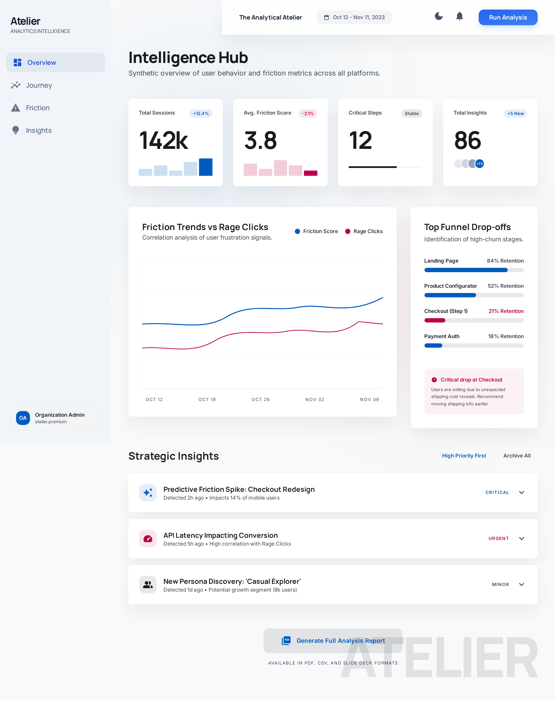
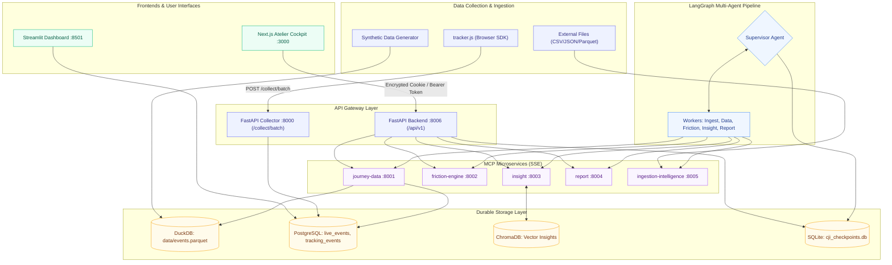

# Atelier Intelligence (Customer Journey Intelligence)

> **Working Prototype: An enterprise agentic intelligence platform that transforms multi-source customer journey telemetry into deterministic friction scores, root-cause AI insights, and executive HTML reports via a LangGraph multi-agent pipeline, 5 Model Context Protocol (MCP) microservices, and a Next.js Cockpit.**

> **Naming & Package Conventions:** In product interfaces and documentation, the platform is named **Atelier Intelligence** (or **Atelier**). The internal Python distribution package, configuration keys, and command-line entry points retain the `cji` prefix (e.g. `cji`, `cji-servers`, `cji-api`, `CJI_HOME`).

---

### Repository Metadata

- **Description:** Working Prototype: Enterprise agentic intelligence platform turning customer journey telemetry into deterministic friction scores, root-cause insights, and executive reports via LangGraph and MCP.
- **Topics:** `langgraph`, `mcp`, `agentic-ai`, `customer-journey`, `friction-analysis`, `nextjs`, `fastapi`, `working-prototype`
- **License:** [MIT License](LICENSE)

---

## Table of Contents

1. [Why Atelier Intelligence?](#why-atelier-intelligence)
2. [Platform Overview & Visuals](#platform-overview--visuals)
3. [Features](#features)
4. [Quickstart](#quickstart)
5. [System Architecture](#system-architecture)
6. [Demo Mode Walkthrough](#demo-mode-walkthrough)
7. [Importing Event Files](#importing-event-files)
8. [Realtime Mode Walkthrough](#realtime-mode-walkthrough)
9. [Backend REST API](#backend-rest-api)
10. [Next.js Cockpit Frontend](#nextjs-cockpit-frontend)
11. [Environment Variables Reference](#environment-variables-reference)
12. [Guardrails & AI Safety](#guardrails--ai-safety)
13. [LangSmith Observability](#langsmith-observability)
14. [Production Operations](#production-operations)
15. [Testing & Quality Assurance](#testing--quality-assurance)
16. [Security Practices](#security-practices)
17. [Frequently Asked Questions](#frequently-asked-questions)

---

## Why Atelier Intelligence?

### The Problem

Modern growth, product, and engineering teams lose millions annually in user funnel abandonment (such as SaaS onboarding, checkout funnels, and KYC verification flows):

- **Traditional Analytics are Shallow:** Platforms like Google Analytics 4, Mixpanel, or Amplitude tell you *that* users dropped off (e.g., "42% abandonment on Step 3"), but they cannot explain *why*.
- **The Investigation Tax:** Isolating root causes requires cross-referencing disparate data silos—session replays (Hotjar, UXCam), APM server logs (Datadog, CloudWatch), and customer support tickets (Zendesk). Teams spend 10–20 engineering hours per sprint manually diagnosing friction points.
- **Delayed Remediation:** By the time product teams diagnose an onboarding hurdle or confusing form field, weeks have passed, ad budgets are wasted, and conversion velocity is permanently lost.

### The Atelier Solution

Atelier Intelligence bridges the gap between raw telemetry and immediate engineering resolution:

1. **Deterministic Friction Engine:** Mathematical scoring across five empirical signals: drop-off rates, error frequencies, rage clicks, dwell times, and retry loops (computed using DuckDB for local analytics and PostgreSQL for live production).
2. **LangGraph Multi-Agent Collaboration:** A Supervisor agent coordinates specialized worker agents (Ingestion, Journey Data, Friction Scoring, Insight Generation, and Report Synthesis) running over 5 Model Context Protocol (MCP) microservices.
3. **Automated Root Cause & Remediation:** LLM agents analyze critical friction steps, retrieve historical patterns from ChromaDB vector stores, and generate actionable root-cause hypotheses alongside prioritized engineering tickets.
4. **Self-Contained Executive Artifacts:** Generates zero-dependency standalone HTML reports featuring inline SVG funnel visualizations, accessible color palettes, and strict Content Security Policies (`script-src 'none'`).

---

## Platform Overview & Visuals

### Atelier Intelligence Cockpit

The modern Next.js 16 Cockpit provides an executive Bento-grid dashboard, live telemetry streaming, funnel friction drill-downs, run execution controls, and self-serve API key provisioning:



### Sample Standalone Executive Report

Every analysis run can produce an immutable, self-contained HTML report with embedded SVGs, friction tables, and AI insights:

📄 **[View Sample Executive Friction Report (HTML)](assets/sample_report.html)**

---

## Features

| Capability | Detail |
|---|---|
| **Dual Execution Modes** | `demo` queries local `data/events.parquet` via DuckDB; `realtime` queries PostgreSQL (`tracking_events` and `live_events`). |
| **Deterministic Friction Scoring** | Normalized 0–100 score weighted across: Drop-offs (40%), Errors (25%), Rage Clicks (15%), Dwell Outliers (10%), Retries (10%). |
| **Agentic Root-Cause Insights** | Groq / Anthropic LLM completions per critical step, cached in ChromaDB; rule-based fallback without external API keys. |
| **Standalone Executive Reports** | Zero-dependency UTF-8 HTML report with inline SVG funnels, friction matrices, and provenance metadata (no external CDN scripts). |
| **Multi-Agent Orchestration** | LangGraph sequential workflow with a supervisor and 5 dedicated worker nodes; durable checkpointing via SQLite. |
| **Smart Ingestion Intelligence** | Schema detection and column fingerprinting for CSV, JSON, Excel, and Parquet data files. |
| **Dual Frontends** | Modern Next.js 16 Cockpit (`:3000`) with encrypted session cookies, plus secondary Streamlit dashboard (`:8501`). |
| **Comprehensive Observability** | OpenTelemetry correlation IDs, Prometheus metrics, JSON structured logging, and optional LangSmith tracing. |

---

## Quickstart

> **Prerequisite:** Python 3.12+ and Node.js 22.12+.

### 🚀 One-Click Automated Startup (Recommended)

To launch the full CJI ecosystem (5 MCP servers on ports 8001–8005, the FastAPI backend on port 8006, and the Next.js Cockpit on port 3000) with automatic port conflict reaping and virtual environment activation:

#### Windows (PowerShell)
```powershell
.\start-cji.ps1
```
To stop all services and release listening ports:
```powershell
.\stop-cji.ps1
```

#### macOS / Linux (Bash)
```bash
chmod +x start-cji.sh stop-cji.sh
./start-cji.sh
```
To stop all services:
```bash
./stop-cji.sh
```

#### Running Endpoints:
- **Cockpit Web UI:** [http://localhost:3000](http://localhost:3000)
- **Backend REST API:** [http://127.0.0.1:8006/api/v1](http://127.0.0.1:8006/api/v1)
- **5 MCP Servers (SSE):** `http://127.0.0.1:8001..8005/sse`

---

### Manual CLI Setup

```bash
# 1. Create a virtual environment inside cji_agent/
cd cji_agent
python -m venv .venv
.venv\Scripts\activate            # Windows
# source .venv/bin/activate       # macOS / Linux

# 2. Install locked dependencies and the cji package
pip install -r requirements.lock
pip install --no-deps -e .

# 3. Configure environment (demo mode runs with zero external secrets)
cp .env.example .env
cji-settings check

# 4. Start the 5 MCP servers
cji-servers --mode demo

# 5. In a second terminal: trigger a pipeline run on demo data
cji --mode demo --run --auto-approve
```

---

### Commands Summary

| Command | Purpose |
|---|---|
| `cji` | Main CLI: run analysis pipelines, inspect checkpoints, approve runs, and resume tasks |
| `cji-servers` | Start the five Model Context Protocol (MCP) servers |
| `cji-api` | Run the FastAPI backend REST API (`/api/v1`) on port 8006 |
| `cji-collector` | High-throughput FastAPI event intake collector on port 8000 |
| `cji-dashboard` | Launch the Streamlit analytical dashboard on port 8501 |
| `cji-api-token` | Create, list, inspect, and revoke backend API bearer tokens |
| `cji-settings` | Check environment variables, paths, and active service registries |
| `cji-ingest-json` | Convert external analytics files (GA4, Hotjar, UXCam) into PostgreSQL |
| `cji-snippet` | Generate client-side tracker embed scripts and React hooks |
| `cji-generate-diverse`| Synthesize high-friction multi-journey datasets for load testing |
| `cji-db` | Manage PostgreSQL schema migrations (`migrate up`, `down`, `status`) |
| `cji-backup` | Create, verify, and restore full database and SQLite checkpoint backups |
| `cji-ops` | System operational status and audit log retention maintenance |
| `cji-trace` | Trace an individual request ID through the API, workflow, and MCP calls |

---

## System Architecture



### Microservices Port Allocation

| Port | Service | Protocol | Role |
|---|---|---|---|
| **3000** | Next.js Cockpit | HTTP | Modern Bento-grid Web UI with live streaming telemetry |
| **8000** | cji-collector | HTTP | High-throughput browser telemetry collector (`/collect/batch`) |
| **8001** | cji-journey-data | MCP / SSE | Journey metrics, funnels, and event queries |
| **8002** | cji-friction-engine | MCP / SSE | Pure mathematical friction calculation functions |
| **8003** | cji-insight | MCP / SSE | LLM root-cause synthesis and ChromaDB retrieval |
| **8004** | cji-report | MCP / SSE | Standalone self-contained HTML report renderer |
| **8005** | cji-ingestion-intelligence | MCP / SSE | Schema inference and data mapping engine |
| **8006** | cji-api | HTTP | Production REST API (`/api/v1`) |
| **8501** | cji-dashboard | HTTP | Legacy Streamlit visual analytics client |

---

## Demo Mode Walkthrough

```bash
# 1. Regenerate demo parquet dataset (2,000 sessions, seed 42)
cji --mode demo --generate-data --sessions 2000 --seed 42

# 2. Start MCP microservices in demo mode
cji-servers --mode demo

# 3. Execute analysis run with auto-approval
cji --mode demo --run --auto-approve

# 4. Optional: Run with human-in-the-loop checkpoint approval
cji --mode demo --run
cji --approve --thread-id <thread-id>

# 5. Inspect status or resume interrupted run
cji --status --thread-id <thread-id>
cji --resume --thread-id <thread-id>
```

---

## Importing Event Files

Atelier supports multi-format file ingestion through two paths:

```bash
# Path 1: Smart ingestion via the LangGraph pipeline (automatic schema mapping)
cji --mode demo --ingest --file data.json --source-hint "GA4 Export" --run --auto-approve

# Path 2: Direct conversion into PostgreSQL tracking_events
cji-ingest-json export.csv --map userId=user_id page=step_id
cji-ingest-json export.json --replace   # Replaces table rows safely
```

---

## Realtime Mode Walkthrough

Realtime mode streams browser events directly into PostgreSQL (`live_events` and `tracking_events`).

### 1. Start the Collector
```bash
cji-collector
```

### 2. Embed the Tracker SDK
Generate an embed snippet for your application:
```bash
cji-snippet --journey user_onboarding --api-key <your-admin-key>
```

Add the generated snippet to your frontend HTML:
```html
<script>
  window.CJI_CONFIG = {
    api_key: "cji_dev_localtest",
    journey_name: "user_onboarding",
    collector_url: "http://127.0.0.1:8000/collect/batch"
  };
</script>
<script src="http://127.0.0.1:8000/tracker.js" async></script>
```

---

## Backend REST API

The FastAPI backend runs on port 8006 and provides RFC 9457 Problem Details errors, Bearer token authentication, rate limiting, and signed cursor pagination:

```bash
# 1. Provision an API token
cji-api-token create --label web-client --role viewer --journey user_onboarding

# 2. Launch the API server
cji-api

# 3. Query journey metrics
curl -H "Authorization: Bearer <TOKEN>" http://127.0.0.1:8006/api/v1/journeys/user_onboarding/metrics
```

### Core API Endpoints

| Method & Route | Role | Returns |
|---|---|---|
| `GET /api/v1/health` | Public | Liveness, readiness, and system version |
| `GET /api/v1/me` | Viewer | Calling token metadata, role, and authorized journeys |
| `GET /api/v1/journeys` | Viewer | Configured customer journeys and funnel steps |
| `GET /api/v1/journeys/{id}/metrics` | Viewer | Drop-off rates, conversion percentages, dwell times |
| `GET /api/v1/journeys/{id}/friction` | Viewer | Step-by-step 0–100 friction scores and severity ratings |
| `GET /api/v1/journeys/{id}/insights` | Viewer | Root-cause analysis, engineering tickets, and fixes |
| `GET /api/v1/journeys/{id}/events` | Operator | Paginated raw event stream with timestamp filtering |
| `GET /api/v1/runs` | Viewer | History of analysis runs, status, and execution timings |
| `POST /api/v1/runs/{id}/approval` | Operator | Idempotent approval triggering executive report generation |
| `GET /api/v1/reports/{id}/content` | Viewer | Sandboxed executive HTML report |

---

## Next.js Cockpit Frontend

The `frontend/` directory houses a Next.js 16 (React 19, TypeScript, Tailwind CSS) cockpit application:

- **Enterprise Security:** API keys are never exposed to browser client code. The Next.js server wraps credentials in an encrypted `HttpOnly`, `SameSite=Strict` cookie.
- **Dynamic Bento Analytics:** Five interactive sub-screens (Overview, Friction Drill-Down, Intelligence Hub, Connections & Tracker Keys, and Team Operations).
- **Live Telemetry Stream:** Real-time event synthesis simulating incoming user traffic across onboarding steps.

```bash
cd frontend
npm ci
cp .env.example .env.local
npm run build && npm start
```

---

## Environment Variables Reference

| Variable | Default | Purpose |
|---|---|---|
| `CJI_ENV` | `production` | Environment mode (`development`, `test`, `production`). |
| `CJI_MODE` | `demo` | Data source mode (`demo` for DuckDB/Parquet, `realtime` for PostgreSQL). |
| `JOURNEY_NAME` | `user_onboarding` | Active customer journey under evaluation. |
| `CJI_HOME` | Current directory | Working directory for checkpoints, reports, and data. |
| `DATABASE_URL` | none | PostgreSQL connection string for realtime mode. |
| `SUPABASE_DATABASE_URL` | none | Fallback PostgreSQL connection string. |
| `CJI_LLM_PROVIDER` | `groq` | Active LLM provider (`groq`, `anthropic`, or `none` for deterministic fallback). |
| `LLM_MODEL` | provider default | Active LLM model (e.g. `openai/gpt-oss-120b` or `claude-sonnet-4-6`). |
| `GROQ_API_KEY` | none | API key for Groq LLM inference. |
| `ANTHROPIC_API_KEY` | none | API key for Anthropic Claude inference. |
| `CJI_API_PORT` | `8006` | Port for the FastAPI backend REST API. |
| `CJI_SESSION_SECRET` | none | 32+ character random secret for Next.js cookie encryption. |
| `LANGCHAIN_TRACING_V2` | `false` | Enable LangSmith observability tracing. |
| `LANGCHAIN_PROJECT` | `atelier-intelligence`| Project identifier in LangSmith. |

---

## Guardrails & AI Safety

- **PII Sanitization:** The pipeline strips `user_id`, `session_id`, `ip_address`, `email`, and verbatim inputs prior to LLM dispatch (`guardrails/sanitiser.py`).
- **Structured Pydantic Coercion:** All LLM outputs are validated and coerced against typed schemas (`guardrails/output_validator.py`); malformed outputs automatically fall back to rule-based insights.
- **Strict Budget & Rate Limits:** Guardrails enforce max token limits, deadline timeouts (90s), and cost thresholds per analysis run.
- **Report Security Sandbox:** Reports are generated with strict Content Security Policy meta tags (`default-src 'none'; style-src 'sha256-...'; script-src 'none'`), rendering SVG charts directly without inline scripts or external CDNs.

---

## LangSmith Observability

To enable end-to-end distributed agent tracing:

```bash
# In cji_agent/.env
LANGCHAIN_TRACING_V2=true
LANGCHAIN_API_KEY=your_key_here
LANGCHAIN_PROJECT=atelier-intelligence
```

---

## Production Operations

CJI is engineered for high-availability deployment behind a TLS reverse proxy:

- **Deployment & Backups:** Create and restore atomic backups using `cji-backup create` and `cji-backup restore`.
- **Database Migrations:** Schema evolution handled via `cji-db migrate up`.
- **Health Probes:** Public liveness endpoints (`/health/live`), database readiness checks (`/health/ready`), and Next.js `/readyz`.
- **Prometheus Metrics:** Native `/metrics` scrapers for API latency, error rates, and queue depth.
- **Audit Logging:** Security actions (token provisioning, logins, run approvals) recorded to immutable JSONL audit files (`CJI_AUDIT_DIR`).

---

## Testing & Quality Assurance

### Frontend Test Suite (Vitest & Testing Library)

The Next.js Cockpit includes 19 component and integration test suites covering accessibility (axe), authentication, bento metric calculations, connection provisioning, and view rendering:

```bash
cd frontend
npm test
```
*Result: 19 test files passed, 177 tests passed (100% pass rate).*

### Python Backend Unit & Contract Tests

Run core unit and contract tests across scoring algorithms and models:

```bash
cd cji_agent
pytest tests/test_friction_engine.py tests/test_collector_models.py
```

### Static Analysis, Linting & Type Checks

```bash
# Python backend quality checks
cd cji_agent
ruff check
mypy
bandit -c pyproject.toml -r src

# Frontend type checking and ESLint
cd frontend
npm run typecheck
npm run lint
```

---

## Security Practices

- **Zero-Secret Baseline:** Environment secrets are never committed. Example templates (`.env.example`) contain placeholders only.
- **Encrypted Session Boundary:** Next.js sessions use AES-256-GCM encrypted cookies; client browsers never see or store the underlying API tokens.
- **Fail-Closed Production Rules:** In production mode (`CJI_ENV=production`), the collector and API fail to start if admin keys or cursor secrets are missing or default.
- **Strict SQL Parameterization:** All DuckDB and PostgreSQL database queries use parameterized placeholders to eliminate SQL injection risks.

---

## Frequently Asked Questions

**Q: `cji --run` fails with "Startup check failed for cji-..."**  
A: Start the MCP servers first using `cji-servers --mode demo` (or launch everything at once via `.\start-cji.ps1` / `./start-cji.sh`).

**Q: What is the difference between Demo and Realtime modes?**  
A: Demo mode operates entirely offline using local Parquet files (`data/events.parquet`) and DuckDB, requiring zero external databases or API keys. Realtime mode connects to PostgreSQL to ingest and analyze live browser telemetry.

**Q: Where is the generated executive report saved?**  
A: Reports are written to `reports/cji_report_<journey>_<run_id>.html`. The path is printed upon run completion and is also viewable in the Next.js Cockpit.

**Q: What happens if an LLM API key is not configured?**  
A: Atelier gracefully degrades to a deterministic, rule-based insight engine. It will still compute exact friction scores, generate SVG funnel charts, and synthesize prioritized remediation tickets without external API calls.
