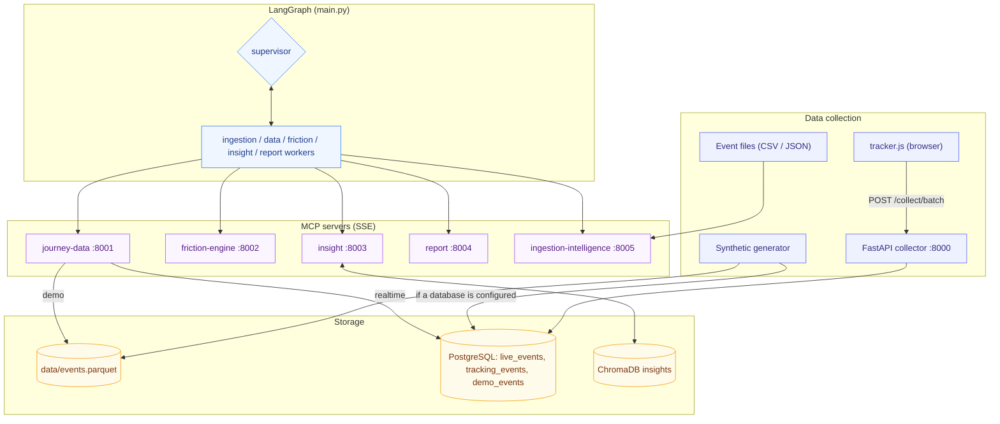

# Customer Journey Intelligence (CJI)

> **Proof-of-concept system that turns user-behaviour events into friction scores, root-cause insights and a standalone HTML report, using a LangGraph multi-agent pipeline and five MCP servers.**

Commands below are run from `cji_agent/` unless stated. Comprehensive setup and operational runbooks are documented below.

---

## Table of Contents

1. [Why CJI?](#why-cji)
2. [Features](#features)
3. [Quickstart](#quickstart)
4. [System Architecture](#system-architecture)
5. [Demo Mode Walkthrough](#demo-mode-walkthrough)
6. [Importing Event Files](#importing-event-files)
7. [Realtime Mode Walkthrough](#realtime-mode-walkthrough)
8. [Backend API](#backend-api)
9. [Web Frontend](#web-frontend)
10. [Environment Variables Reference](#environment-variables-reference)
11. [Guardrails](#guardrails)
12. [LangSmith Tracing](#langsmith-tracing)
13. [Testing & Code Quality](#testing-security--quality-assurance)
14. [Security Practices](#security-practices)
15. [Known Issues & FAQ](#known-issues--faq)

---

## Why CJI?

Most analytics tools show *what* happened. CJI computes a deterministic **friction score** for every step of a user
journey, then asks an LLM for the likely root cause and a prioritised fix, and summarises the result in a standalone
HTML report.

---

## Features

| Capability | Detail |
|---|---|
| **Two modes** | `demo` reads `data/events.parquet` with DuckDB; `realtime` reads PostgreSQL (`tracking_events` and `live_events`) |
| **Friction engine** | Deterministic weighted score per step: drop-off, errors, rage clicks, dwell time, retries |
| **Insights** | LLM root cause and fix per critical step, stored in ChromaDB; rule-based fallback without an API key |
| **Report** | Self-contained HTML report (no scripts, no external files): narrative, SVG funnel chart, friction table, insight cards and provenance |
| **Orchestration** | LangGraph supervisor and five worker nodes; optional human approval before the report |
| **Smart ingestion** | LLM-assisted mapping of CSV/JSON/Excel/Parquet files to the event schema |
| **Dashboard** | Streamlit: KPIs, funnel, friction, heatmap, audience, insights, file upload |
| **Observability** | LangSmith tracing, off by default |

---

## Quickstart

> **Prerequisite:** Python 3.12 or newer (`requires-python = ">=3.12"`; tested with 3.12), Node.js 22.12+.

### 🚀 One-Click Automated Startup (Recommended)

To launch the full CJI ecosystem (5 MCP servers on ports 8001–8005, the FastAPI backend on port 8006, and the Next.js Cockpit on port 3000) with automatic port reaping and virtual environment activation:

```powershell
.\start-cji.ps1
```

To stop all background CJI servers and safely release all listening ports:

```powershell
.\stop-cji.ps1
```

Once started:
- **Cockpit Web UI:** [http://localhost:3000](http://localhost:3000)
- **Backend REST API:** [http://127.0.0.1:8006/api/v1](http://127.0.0.1:8006/api/v1)
- **MCP Servers (SSE):** `http://127.0.0.1:8001..8005/sse`

---

### Manual CLI Setup

CJI is the installable package `cji` (distribution `cji-agent`, sources in `cji_agent/src/cji/`). Install the exact
tested dependency set from the lock file, then the package itself:

```bash
# 1. Create a virtual environment inside cji_agent/
cd cji_agent
python -m venv .venv
.venv\Scripts\activate            # Windows
# source .venv/bin/activate       # macOS / Linux

# 2. Install the locked dependencies (runtime and dev tools, hash-checked), then the package (editable)
pip install -r requirements.lock
pip install --no-deps -e .

# 3. Configure (demo mode needs no secrets)
cp .env.example .env
cji-settings check

# 4. Start the five MCP servers (keep this terminal open)
cji-servers --mode demo

# 5. In a second terminal: run the pipeline on the bundled demo data
cji --mode demo --run --auto-approve
```

`requirements.lock` pins every package (runtime plus the `dev` dependency group) with hashes;
`pyproject.toml` declares the supported ranges. `requirements.txt` and `requirements-dev.txt` only include the lock,
so `pip install -r requirements.txt` still works. `--no-deps` keeps pip from resolving anything beyond the lock.
To rebuild the lock after a deliberate upgrade, run `uv pip compile pyproject.toml -o requirements.lock`.

The report is written to `reports/cji_report_<journey>_<run id>.html`; the CLI prints the path. A summary for the
dashboard is written to `data/last_run.json`.

To open the dashboard (port 8501):

```bash
cji-dashboard
```

### Runtime home (`CJI_HOME`)

`data/`, `reports/`, `.env`, the checkpoint database and generated snippets live in the runtime home: `CJI_HOME` if
set (a relative value is resolved against the working directory), otherwise the working directory. Run the commands
from `cji_agent/` to use the bundled `data/events.parquet`, or set `CJI_HOME` to another directory to run from
anywhere. `cji-settings check` prints the resolved `home`. `CJI_HOME` itself is read from the environment, not from
`.env`. `cji-servers` and the dashboard start their child processes in the same home.

### Commands

| Console script | Old command (still works from `cji_agent/`) | Purpose |
|---|---|---|
| `cji` | `python main.py` | Generate demo data, run, approve, resume and inspect analyses |
| `cji-servers` | `python run_servers.py` | Start the five MCP servers |
| `cji-settings` | `python -m settings` | `check` the configuration (secrets redacted) |
| `cji-dashboard` | `streamlit run dashboard.py` | Streamlit dashboard; extra arguments go to `streamlit run` |
| `cji-collector` | `python -m uvicorn collector.api:app` | Collector API on the configured collector endpoint |
| `cji-api` | none (new in Spec 12) | Backend API `/api/v1` on the configured api endpoint ([Backend API](#backend-api)) |
| `cji-api-token` | none (new in Spec 12) | Create, list and revoke backend API tokens |
| `cji-ingest-json` | `python tools/ingest_json.py` | Import event files into PostgreSQL `tracking_events` |
| `cji-snippet` | `python tracker/snippet_generator.py` | Write the tracker embed snippet for a journey key |
| `cji-generate-diverse` | `python generate_diverse.py` | Generate the large, high-friction demo dataset |
| `cji-db` | none (new in Spec 15) | PostgreSQL schema migrations: `migrate up`, `down --to N`, `status` |
| `cji-backup` | none (new in Spec 15) | `create`, `verify` and `restore` backups of the database tables, SQLite stores and files |
| `cji-ops` | none (new in Spec 15) | `status` (readiness of every service) and `maintenance` (audit retention, expired uploads) |
| `cji-trace` | none (new in Spec 15) | `show TRACE_ID`: one request through the API, the workflow and the MCP servers |

The old commands are small launchers in `cji_agent/` that call the installed package; they print the install
command and exit 2 if `cji` is not installed. Each server also runs as a module, e.g.
`python -m cji.mcp_servers.journey_data_server`.

---

## System Architecture



| Part | Location | What it does |
|---|---|---|
| Journey data | `mcp_servers/journey_data_server.py` | Step metrics, funnel, events, live snapshot through a repository chosen once by `CJI_MODE` (`repositories/`) |
| Friction engine | `mcp_servers/friction_engine_server.py` | Pure scoring functions |
| Insight | `mcp_servers/insight_server.py` | Groq chat completion per critical step, guardrails, ChromaDB storage and ranking |
| Report | `mcp_servers/report_server.py`, `reporting/` | Narrative (Groq, template fallback); the HTML report is validated, rendered and written by `reporting/` |
| Ingestion intelligence | `mcp_servers/ingestion_intelligence_server.py` | Schema detection (Anthropic, then Groq), mapping, validation, writes through the repository |
| Supervisor and workers | `agents/supervisor.py`, `agents/workers.py`, `agents/ingestion_worker.py` | Deterministic routing; each worker calls its MCP server; a step that still fails after its retries stops the run with a structured error |
| Graph and workflow | `graph.py`, `workflow/`, `main.py` | Sequential graph; `workflow/runtime.py` stores a checkpoint after every worker (SQLite, `CJI_CHECKPOINTS_DB`), pauses before the report unless `--auto-approve`, and resumes interrupted or failed runs |
| Settings | `settings/` | Typed configuration and the service registry (ports, transport, URLs) |
| Collector | `collector/api.py` | Browser event intake for realtime mode |
| Dashboard | `dashboard.py` | Streamlit client; reads PostgreSQL in both modes plus `data/last_run.json` |

Source paths in this table are relative to `cji_agent/src/cji/` (the `cji` package).

Ports and transports come from the service registry (`settings/services.py` in the package):

| Port | Service |
|---|---|
| 8000 | collector (HTTP) |
| 8001 | cji-journey-data (MCP over SSE) |
| 8002 | cji-friction-engine |
| 8003 | cji-insight |
| 8004 | cji-report |
| 8005 | cji-ingestion-intelligence |
| 8501 | dashboard (Streamlit) |

Override a port with `CJI_<SERVICE>_PORT` (for example `CJI_REPORT_PORT`) or point at a remote service with
`CJI_<SERVICE>_URL`.

---

## Demo Mode Walkthrough

```bash
# Optional: regenerate data/events.parquet (2,000 sessions, seed 42)
cji --mode demo --generate-data --sessions 2000 --seed 42

# Start the servers in demo mode, then run the pipeline in another terminal
cji-servers --mode demo
cji --mode demo --run --auto-approve

# Without --auto-approve the run pauses before the report; approve it with the printed thread id
cji --mode demo --run
cji --approve --thread-id <thread-id>

# Inspect a run, or continue one that was interrupted (process killed, timeout) or failed
cji --status --thread-id <thread-id>
cji --resume --thread-id <thread-id>
```

Runs are durable (Spec 09):
- **Checkpoints.** A checkpoint is stored after every worker, so `--resume` re-runs only the step that was interrupted. Completed steps are never executed again.
- **Retries.** A step that fails is retried only for transient errors (timeouts, connection failures, provider 5xx/429), up to `CJI_WORKFLOW_STEP_ATTEMPTS`.
- **Failures.** A step that still fails stops the run as `failed`. `--status` shows the step, its error code and message.
- **Approval.** `--approve` works only for a run awaiting approval; approving twice does nothing.
- **Concurrency.** One process at a time may work on a run.
- **No duplicates.** Reports are named by run (`cji_report_<journey>_<run id>.html`), insights are stored under run-scoped ids, and ingested rows without an `event_id` get ids derived from their content. Rerunning or resuming a step therefore never duplicates them.
- **Exit codes.** 0 for completed or paused, 1 for failed or refused, 2 for configuration errors.

Notes:
- With `DATABASE_URL` or `SUPABASE_DATABASE_URL` set (and `CJI_ENV` not `test`), `--generate-data` also **replaces**
  the `demo_events` table in that database, which the dashboard's "demo_events track" reads.
- `--window-days` is accepted for demo runs; demo queries currently read the whole file.
- `cji-generate-diverse` creates a larger (about 1M events), high-friction dataset. It overwrites
  `data/events.parquet`; restore the default with `--generate-data`.
- The CLI and the servers must use the same mode. A realtime run against demo servers stops with
  `ModeMismatch`; restart the servers with `cji-servers --mode realtime`.

---

## Importing Event Files

Two paths exist:

```bash
# 1. Smart ingestion through the pipeline (LLM-assisted mapping; writes through the repository:
#    demo -> data/events.parquet, realtime -> PostgreSQL tracking_events). Servers must be running.
cji --mode demo --ingest --file <path> --source-hint "GA4 export" --run --auto-approve

# 2. Direct conversion of known formats (GA4, Hotjar, UXCam, surveys, tickets, combined CSV, NDJSON)
#    into PostgreSQL tracking_events. Appends by default, skipping event_ids already stored.
cji-ingest-json <file>
cji-ingest-json <file> --map userId=user_id page=step_id
cji-ingest-json <file> --replace      # replaces the whole tracking_events table
```

The dashboard's **Upload Events** panel uses path 2. It appends by default; the **Replace all rows in
tracking_events** box replaces the table and shows a warning first. Path 2 needs a database URL.

---

## Realtime Mode Walkthrough

Realtime mode reads events from PostgreSQL: `live_events` (written by the collector) and `tracking_events`
(written by file imports).

### 1. Start the collector

```bash
# Requires DATABASE_URL (or SUPABASE_DATABASE_URL). Outside CJI_ENV=development it also requires
# CJI_ADMIN_KEY (32+ random characters) and CJI_CORS_ORIGINS.
cji-collector                       # uvicorn on the configured endpoint (default 127.0.0.1, port 8000)
# same as: python -m uvicorn cji.collector.api:app --host 127.0.0.1 --port 8000
```

| Route | Purpose |
|---|---|
| `GET /health/live` | Liveness: always 200 `{"status": "ok"}`; no database access |
| `GET /health/ready` | Readiness: 200 `{"status": "ready"}` when PostgreSQL and both collector tables answer, else 503 `{"status": "not_ready"}` |
| `GET /health` | Readiness plus the `live_events` row count (kept for existing monitors) |
| `GET /tracker.js` | Serves the browser tracker |
| `POST /collect/batch` | Receives 1–100 events with a per-journey API key; stores them before answering |
| `GET /live/stats` | Event counts per step for the last N minutes (`?minutes=`, 1–43200); requires `X-CJI-Admin-Key` |
| `POST /admin/api-keys` | Creates a per-journey tracker key; requires the `X-CJI-Admin-Key` header |

In `CJI_ENV=development` the collector registers the local test key `cji_dev_localtest` for `JOURNEY_NAME`.

**`POST /collect/batch` contract.** Body `{"api_key": "...", "events": [...]}` as `application/json`, or as
`text/plain` JSON (what `navigator.sendBeacon` sends). If an `X-CJI-Key` header is sent it must equal `api_key`.
A key may only write events whose `journey_name` is the journey it was created for. The collector writes all valid
events of a batch in one transaction and answers after the commit:

| HTTP | `status` | Meaning |
|---|---|---|
| 200 | `stored` | Every event is stored (now or by an earlier request) |
| 207 | `partial` | Valid events are stored; `errors` lists the rejected ones by `index` |
| 422 | `rejected` | No event was valid (or the envelope is malformed: missing key, 0 or more than 100 events) |
| 400 / 401 / 413 / 415 | `rejected` | Invalid JSON / unknown, inactive or mismatched key / body too large / other content type |
| 429 | `rejected` | Rate limit; wait `Retry-After` seconds |
| 503 | `failed` | Nothing was stored (database unavailable or the write failed); retry with the same `event_id` values |

The body always has `request_id`, `received`, `accepted`, `duplicates` and `rejected`. `event_id` is the
idempotency key: a retried event counts as a duplicate and is stored once. Errors name the failing fields
(`{"index": 2, "event_id": "...", "reason": "invalid", "fields": ["event_type"]}`; `reason` is `invalid` or
`journey_not_authorized`) and never echo submitted values. Every response carries `X-Request-ID` (a valid incoming
`X-Request-ID` of 8–64 characters `A-Z a-z 0-9 . _ -` is kept), and collector log lines carry the same id. Logs show
a key fingerprint, never keys, user, session or event ids, URLs or metadata. Per event: `url` at most 2048
characters (after the query string is removed), `element_selectors` at most 512, `metadata` at most 8192 bytes of
JSON. Rate limits are counted per process; with several workers each worker has its own buckets.

### 2. Embed the tracker

Create a journey key with `POST /admin/api-keys` (header `X-CJI-Admin-Key`, body
`{"journey_name": "...", "description": "..."}`), then generate an embed snippet:

```bash
cji-snippet --journey user_onboarding --api-key <key from POST /admin/api-keys>
```

This writes `snippets/embed_snippet.html`, a React hook and `snippets/verify_tracker.py` (under the runtime home)
for that key. The snippet
sets `window.CJI_CONFIG` (`api_key`, `journey_name`, `collector_url` ending in `/collect/batch`, optional
`step_map`) and loads `/tracker.js`. Use the journey the key was created for: events for another journey are
rejected with `journey_not_authorized`. In development, `cji_dev_localtest` works for `JOURNEY_NAME`. The tracker
sends `page_view`, `step_complete`, `error`, `rage_click` and `abandon` events in batches.

### 3. Run the analysis

```bash
cji-servers --mode realtime
cji --mode realtime --run --auto-approve --window-mins 60
```

### 4. Dashboard

`cji-dashboard`, then choose "Live_event track", "tracking_event track" or "demo_events track" in the
sidebar.

---

## Backend API

`cji-api` serves a versioned JSON API under `/api/v1` for the Next.js frontend (default port 8006,
`CJI_API_PORT` / `CJI_API_URL`). It reads the same data, checkpoints and reports as the CLI and the dashboard.
The OpenAPI document is served at `/api/v1/openapi.json` and stored in `cji_agent/openapi/v1.json`
(regenerate with `python -m cji.api.openapi_snapshot`, check with `--check`). The interactive docs at
`/api/v1/docs` exist only with `CJI_ENV=development`.

```bash
# 1. Create a token (printed once; only its SHA-256 hash is stored in CJI_API_TOKENS_FILE)
cji-api-token create --label frontend --role viewer --journey user_onboarding
cji-api-token list                  # ids, labels, roles, journeys and state (never the token)
cji-api-token revoke tok_0123456789ab

# 2. Start the API (outside development: https CJI_API_CORS_ORIGINS and a 32+ character CJI_API_CURSOR_SECRET)
cji-api                             # uvicorn on the configured endpoint (default 127.0.0.1, port 8006)

# 3. Call it
curl -H "Authorization: Bearer $TOKEN" http://127.0.0.1:8006/api/v1/journeys
```

**Authentication and roles.** Every route except `GET /api/v1/health` needs `Authorization: Bearer <token>`.
A token has a role and a journey list (`*` = all journeys):

| Role | Can |
|---|---|
| `viewer` | read health details, journeys, metrics, friction, insights, runs and reports |
| `operator` | viewer, plus raw events and run approval |
| `admin` | operator (reserved for later administrative routes) |

A journey outside the token's list is `403 journey_forbidden`. Runs and reports of such journeys answer
`404`, exactly like ids that do not exist.

**Routes** (all under `/api/v1`):

| Route | Role | Returns |
|---|---|---|
| `GET /health` | none | `{status, version, mode}` |
| `GET /health/details`, `GET /me` | viewer | component status; the calling token (never the secret) |
| `GET /journeys`, `/journeys/{journey_id}` | viewer | configured journeys and their steps |
| `GET /journeys/{journey_id}/metrics`, `/friction` | viewer | step metrics and funnel; friction scores (`days` 1-365, default 30, or `minutes` 1-43200) |
| `GET /journeys/{journey_id}/insights` | viewer | insights of the latest run that has them, or of `run_id` |
| `GET /journeys/{journey_id}/events` | operator | events, newest first (`step_id`, `event_type` filters) |
| `GET /runs`, `/runs/{run_id}` | viewer | runs (`journey_id`, `status` filters); one run with its steps |
| `POST /runs/{run_id}/approval` | operator | approves a run awaiting approval; the report step runs in the background |
| `GET /reports`, `/reports/{report_id}`, `/reports/{report_id}/content` | viewer | report metadata; the HTML, sandboxed by `Content-Security-Policy` |

**Errors.** Every error is `application/problem+json` (RFC 9457) with `type`, `title`, `status`, `detail`,
a stable `code` and the `request_id`; validation errors add `errors: [{location, field, reason}]`. Submitted values,
exception text, paths and SQL never appear in a response. Unknown query parameters are rejected (422). Every
response carries `X-Request-ID` (a valid client value is kept).

**Pagination.** Lists return `{data, page: {limit, next_cursor}}`. `limit` is 1-200 (default 50); pass
`next_cursor` back as `cursor` with the same filters. Cursors are signed and tied to the query.

**Idempotency.** `POST /runs/{run_id}/approval` requires an `Idempotency-Key` header (8-64 of `A-Z a-z 0-9 . _ -`).
Repeating a request with the same key within 24 hours returns the stored response with `Idempotent-Replayed: true`;
the same key with a different request is `409 idempotency_key_reused`. Approval answers `202` when it approved the
run and `200` with `already_approved: true` when the run was approved before. Request bodies are limited to 16 KiB.

**Rate limits.** Per token (`CJI_API_RATE_PER_TOKEN`, default 120/min) and, for requests without a valid token,
per client address (`CJI_API_RATE_PER_IP`, default 60/min). Above them: `429` with `Retry-After`.

---

## Web Frontend

`frontend/` is a Next.js (TypeScript) web app on the backend API: status, journeys with funnel, step metrics and
friction drill-down, runs (start, approve, resume, results with insight provenance), reports (preview and
download) and event file ingestion with validation feedback (Spec 14). It runs on its own with Node 22.12+ and
needs only `cji-api` as its backend; the Streamlit dashboard (`cji-dashboard`) and the CLI stay available as the
fallback. Details: `frontend/README.md`.

```bash
cji-api                                  # backend on port 8006 (see Backend API)
cji-api-token create --label me --role viewer --journey user_onboarding
cd frontend
npm ci
cp .env.example .env.local               # set CJI_SESSION_SECRET (32+ random characters)
npm run build && npm start               # http://localhost:3000, sign in with the token
```

The browser never receives the API token: the Next.js server keeps it in an encrypted `HttpOnly`, `Secure`,
`SameSite=Strict` session cookie and makes every API call itself. Pages without a session redirect to the login
page. Errors from the API are shown with their code and request id and a Retry button. Frontend settings
(`CJI_API_BASE_URL`, `CJI_SESSION_SECRET`, `CJI_API_TIMEOUT_MS`) are read by the Next.js server only and are
documented in `frontend/.env.example`.

Checks: `npm run typecheck`, `npm run lint`, `npm test` (also verifies the generated API types against
`cji_agent/openapi/v1.json`), `npm run test:e2e` (Playwright: the smoke test and one spec per feature against a
fixture API, with the installed Chrome).

---

## Environment Variables Reference

Settings are read from the process environment, then `.env` in the runtime home (`CJI_HOME`, default: the
working directory; never read when `CJI_ENV=test`).
`.env.example` documents every key. `cji-settings check --role <role>` prints the resolved values with secrets
redacted and exits 2 on a configuration error (roles: `cli`, `dashboard`, `collector`, `api`, `launcher`, `mcp:<service>`).

| Variable | Default | Description |
|---|---|---|
| `CJI_ENV` | `production` | `development`, `test` or `production`. Production fails closed on unsafe collector settings. |
| `CJI_MODE` | `demo` | `demo` or `realtime`. |
| `JOURNEY_NAME` | `user_onboarding` | Journey analysed and written into reports. |
| `CJI_HOME` | working directory | Runtime home: `data/`, `reports/`, `.env` and snippets live here. Environment only. |
| `DATABASE_URL` | none | PostgreSQL URL. Required for realtime mode, the collector, file imports and the dashboard data panels. Percent-encode special characters in the password. |
| `SUPABASE_DATABASE_URL` | none | Used when `DATABASE_URL` is unset. |
| `CJI_DATA_DIR` | `cji_agent/data` | Parquet, checkpoints, `data/last_run.json`, ChromaDB. |
| `CJI_REPORTS_DIR` | `cji_agent/reports` | HTML reports. |
| `CJI_SERVICE_HOST` | `127.0.0.1` | Bind and connect host for local services. |
| `CJI_LLM_PROVIDER` | `groq` | `groq`, `anthropic` or `none` (LLM off: rule-based insights and narrative). One provider for insights, narrative and ingestion mapping; never switched automatically. |
| `LLM_MODEL` | provider default | Sent as configured. Defaults: groq `openai/gpt-oss-120b`, anthropic `claude-sonnet-4-6`. A model of the other provider is refused at startup. |
| `LLM_TEMPERATURE` | `0.0` | Sampling temperature. |
| `LLM_MAX_TOKENS` | `2048` | Completion limit. |
| `GROQ_API_KEY` | none | Used when `CJI_LLM_PROVIDER=groq`. Without it, rule-based fallbacks are used. |
| `ANTHROPIC_API_KEY` | none | Used when `CJI_LLM_PROVIDER=anthropic`. |
| `CJI_LLM_TIMEOUT_S` | `30` | Timeout of one LLM HTTP attempt. |
| `CJI_LLM_DEADLINE_S` | `90` | Limit for one LLM call including all retries and waits. |
| `CJI_LLM_RETRY_ATTEMPTS` | `3` | Attempts per LLM call; only timeouts, connection errors, 429 and 5xx are retried (`CJI_LLM_RETRY_MIN_S` / `_MAX_S`: backoff 2–10 s). |
| `CJI_LLM_RATE_PER_MIN` | `30` | LLM calls per minute per server process. |
| `CJI_LLM_RUN_MAX_CALLS` | `20` | LLM calls per analysis run; beyond it the rule-based fallback is used. |
| `CJI_LLM_RUN_MAX_TOKENS` | `50000` | Tokens (input + output) per analysis run. |
| `CJI_LLM_RUN_MAX_COST_USD` | none | Optional cost cap per run; needs `CJI_LLM_PRICE_INPUT_PER_MTOK` and `CJI_LLM_PRICE_OUTPUT_PER_MTOK` (USD per million tokens). |
| `CJI_MCP_CALL_TIMEOUT_S` | `150` | Limit for one MCP tool call from a worker. |
| `CJI_AUDIT_DIR` | `cji_agent/data/audit` | One JSONL audit record per LLM and tool call, workflow step attempt and run status change (metadata only: ids, provider, model, outcome, tokens, timing). `off` disables the files. |
| `CJI_CHECKPOINTS_DB` | `cji_agent/data/cji_checkpoints.db` | Workflow checkpoints and run leases (SQLite). |
| `CJI_WORKFLOW_STEP_TIMEOUT_S` | `900` | Limit for one attempt of one workflow step; must be above `CJI_MCP_CALL_TIMEOUT_S`. |
| `CJI_WORKFLOW_STEP_ATTEMPTS` | `2` | Attempts per step (1 to 5); only transient errors are retried. |
| `CJI_WORKFLOW_RETRY_BACKOFF_S` | `5` | Wait between attempts of a step. |
| `MAX_AGENT_ITERATIONS` | `20` | Supervisor iteration cap. |
| `FRICTION_SCORE_THRESHOLD` | `60` | Steps at or above this score are critical. |
| `REALTIME_WINDOW_MINUTES` | `60` | Realtime analysis window. |
| `CJI_PIPELINE_TIMEOUT_S` | `180` | Dashboard "Run" subprocess limit. |
| `INGESTION_CONFIDENCE_THRESHOLD` | `0.80` | Mappings below it are flagged for review instead of written. |
| `CJI_ADMIN_KEY` | none | Guards `POST /admin/api-keys` and `GET /live/stats`. Shipped example values are refused. |
| `CJI_CORS_ORIGINS` | empty | Comma-separated browser origins allowed to call the collector; `https` in production (plain `http` only for loopback). |
| `CJI_KEEPALIVE_URL` | none | Optional outbound keep-alive ping from the collector. |
| `CJI_COLLECTOR_MAX_BODY_BYTES` | `262144` | Largest accepted request body (413 above it). |
| `CJI_COLLECTOR_RATE_PER_KEY` | `120` | Batches per minute per tracker key (429 above it). |
| `CJI_COLLECTOR_RATE_PER_IP` | `300` | Requests per minute per client address. |
| `CJI_COLLECTOR_ADMIN_RATE_PER_IP` | `10` | Admin requests per minute per client address. |
| `CJI_COLLECTOR_TRUSTED_PROXY_HOPS` | `0` | Proxies in front of the collector; `0` ignores `X-Forwarded-For`. |
| `CJI_API_PORT` | `8006` | Port of `cji-api` (or `CJI_API_URL` for an API running elsewhere). |
| `CJI_API_TOKENS_FILE` | `<CJI_DATA_DIR>/api_tokens.json` | Backend API tokens (SHA-256 hashes, roles, journeys); managed with `cji-api-token`. |
| `CJI_API_RATE_PER_TOKEN` | `120` | Backend API requests per minute per token (429 above it). |
| `CJI_API_RATE_PER_IP` | `60` | Backend API requests per minute per client address without a valid token. |
| `CJI_API_CORS_ORIGINS` | development: `http://localhost:3000`, `http://127.0.0.1:3000` | Comma-separated browser origins allowed to call the backend API; `https` outside development and test. |
| `CJI_API_CURSOR_SECRET` | random per process | HMAC key for page cursors; 32+ characters, required outside development and test. |
| `CJI_API_MAX_ACTIVE_RUNS` | `1` | Runs one API process starts or resumes at once (1-8); more answer 409 `run_capacity_reached`. |
| `CJI_API_MAX_UPLOAD_BYTES` | `10485760` | Size limit of `POST /ingestions/validations` (1 KiB-50 MiB); every other request keeps 16 KiB. |
| `CJI_API_WRITE_OPERATIONS` | `true` | `false` stops serving start, resume and ingestion (emergency operational rollback switch). |
| `CJI_API_TRUSTED_PROXY_HOPS` | `0` | Proxies in front of the API whose `X-Forwarded-For` is trusted (0-5); above 0 the API must listen on loopback. |
| `CJI_API_AUTH_FAILURES_PER_MIN` | `10` | Failed authentications per minute per client address before `429`. |
| `CJI_LOG_FORMAT` | `json` in production, else `text` | Log format; production requires `json`. |
| `CJI_LOG_LEVEL` | `info` | `debug`, `info`, `warning`, `error` or `critical`. |
| `CJI_AUDIT_RETENTION_DAYS` | `90` | `cji-ops maintenance` deletes older audit lines. |
| `CJI_PG_BIN` | found on `PATH` | Directory of `pg_dump`, `pg_restore` and `psql` for `cji-backup`. |
| `CJI_ALLOW_THIRD_PARTY_TRACING` | `false` | Production refuses `LANGCHAIN_TRACING_V2=true` unless this is `true` (prompts leave the host). |
| `LANGCHAIN_TRACING_V2` | `false` | `true` enables LangSmith tracing. |
| `LANGCHAIN_API_KEY` | none | LangSmith key. |
| `LANGCHAIN_PROJECT` | `cji-poc` | LangSmith project. |

`OPENAI_API_KEY` is accepted but not used. `COLLECTOR_HOST` and `COLLECTOR_PORT` still work but are deprecated in
favour of `CJI_COLLECTOR_URL`.

---

## Guardrails

| Layer | Location | Behaviour |
|---|---|---|
| Event validation | `domain/events.py` (used by `collector/api.py`) | Pydantic v2: `event_id` at least 8 characters, allowed event types only, `duration_ms` ≥ 0, unknown fields ignored, 1–100 events per batch, batch `api_key` required; URL query strings and fragments are stripped |
| PII removal before the LLM | `guardrails/sanitiser.py` | Drops `user_id`, `session_id`, `ip_address`, `email`, `verbatim`, `event_id` |
| LLM output validation | `guardrails/output_validator.py` | Coerces category, effort, step and text fields to allowed values; non-dict output becomes a safe fallback insight |
| AI gateway | `integrations/` | Every LLM call (insight, narrative, ingestion mapping) and every worker MCP call: one provider, timeouts and deadline, bounded retries for retryable errors only, rate limit, run budgets, cancellation, correlation ids, audit records without payloads; error messages never contain keys or provider responses |
| Report output | `reporting/` | Every report value is untrusted: checked against a typed contract, cleaned, limited and escaped for its context (see below) |
| Error handling | whole app | Specific exceptions are caught where the failure set is known; workers and MCP calls are boundaries that record a structured error; nothing is swallowed silently (enforced by `tests/test_cleanup.py`) |

### Report output contract

`export_report` (`mcp_servers/report_server.py`) validates its input with `reporting/model.py`, renders it with
`reporting/render.py` and writes it with `reporting/output.py`:

- **Self-contained.** One UTF-8 HTML file with no scripts, no external URLs and no network requests. The funnel chart
  is inline SVG (exact values on hover). A Content-Security-Policy meta tag allows only the report's own style block
  (`default-src 'none'; style-src 'sha256-…'; script-src 'none'`).
- **Escaped by context.** Journey, narrative, insight text, step ids and provenance values are escaped for element
  text or attributes; the data block is JSON that cannot close its tag.
- **Deterministic.** The same input gives the same bytes. The "generated at" time is the narrative's UTC timestamp,
  not the time of writing.
- **Limits.** Narrative 4,000 characters, 50 insights (title 200, other fields 1,000 characters), 100 funnel steps,
  100 friction rows, 1 MiB per file. Longer text is cut with "…" and noted in the report.
- **File name.** `cji_report_<journey slug>_<run id>.html`; the slug keeps only `a-z 0-9 _ -`, and a missing or
  invalid run id is replaced by the input hash. The file is written atomically inside `CJI_REPORTS_DIR` and nowhere else.
- **Provenance.** A "Report details" footer and a JSON block (`schema: cji-report/1`) record the run id, input
  SHA-256, narrative source (LLM or fallback) and model, counts and anything that was cut.
- **Failures.** Invalid input (`report_invalid_input`), an oversize file (`report_too_large`) or a write error
  (`report_write_failed`, retried once) fails the run with that code and leaves no file.

---

## LangSmith Tracing

```bash
# In cji_agent/.env
LANGCHAIN_TRACING_V2=true
LANGCHAIN_API_KEY=<your key from smith.langchain.com>
LANGCHAIN_PROJECT=cji-poc
```

---

## Production Operations

CJI is engineered for controlled deployment behind a TLS reverse proxy:
- **Deployment & Backups:** Install, upgrade, rollback, and automated database backups via `cji-backup` CLI.
- **Operations & Runbooks:** Strict limits, rate limits, AI budget caps, secret rotation, and operational readiness.
- **Verification:** Pre-flight checklists and security gates verified by automated CI scans.
- **Logs:** `CJI_LOG_FORMAT=json` (the default when `CJI_ENV=production`) writes one JSON object per line with
  `request_id`, `run_id` and `trace_id`; `CJI_LOG_LEVEL` sets the level.
- **Health:** `GET /api/v1/health/ready` (public, no details), collector `GET /health/ready`, `GET /health` on each
  MCP server, Next.js `/readyz`; `cji-ops status` checks them all.
- **Metrics:** `GET /api/v1/metrics` (admin token) and collector `GET /metrics` (admin key) in Prometheus text format.
- **Audit:** security actions (tokens, failed sign-ins, runs, approvals, ingestion writes, key changes, backups,
  migrations) go to `security.jsonl` in the audit directory; `CJI_AUDIT_RETENTION_DAYS` (default 90).
- **Rotation:** `cji-api-token rotate`, `CJI_SESSION_SECRET_PREVIOUS` for the Next.js session key, tracker keys
  revoked with `POST /admin/api-keys/revoke`.
- **Checks:** `cji-settings check --role production` validates a release host; `python ci/run_ci.py` runs the local CI
  and `python ci/release_check.py` the release checklist.
- **Production requires `CJI_MODE`** when `CJI_ENV=production` is set (no silent demo data), and
  `cji-ingest-json --replace` now deletes the table's rows instead of recreating the table.

## Testing, Security & Quality Assurance

> **Repository Hygiene Notice:** Comprehensive internal test suites (`cji_agent/tests/`, `frontend/tests/`, `frontend/e2e/`), synthetic datasets, and design specifications are maintained in the private developer workspace and excluded from the public git tracking for zero-bloat deployment hygiene.

To run code quality, linting, security audits, and type checking from `cji_agent/`:

```bash
ruff check
mypy
bandit -c pyproject.toml -r src
```

Tool settings live in `pyproject.toml` (`[tool.pytest.ini_options]`, `[tool.ruff]`, `[tool.mypy]`, `[tool.bandit]`).

Frontend type check and lint from `frontend/`:
```bash
npm run typecheck
npm run lint
```

---

## Security Practices

- `cji_agent/.env` is gitignored; `.env.example` contains no secrets.
- Outside `CJI_ENV=development` the collector refuses to start without a real admin key, an explicit origin list and
  a database URL.
- The development tracker key is only registered when `CJI_ENV=development`.
- Error responses do not include database driver messages; credentials are stripped from dashboard warnings.
- `cji-ingest-json <file> --replace` and the dashboard's replace box delete every row in
  `tracking_events` of the configured database. Point `DATABASE_URL` at the intended database first.

---

## Known Issues & FAQ

**`cji --run` fails with "Startup check failed for cji-…".**
Start the servers first: `cji-servers --mode demo` (or `--mode realtime`).

**`cji: command not found`, or an old command says "The cji package is not installed".**
Activate the virtual environment and install the package from `cji_agent/`: `pip install -r requirements.lock`, then
`pip install --no-deps -e .`.

**The CLI cannot find `data/events.parquet`.**
Paths are relative to the runtime home. Run from `cji_agent/` or set `CJI_HOME`; `cji-settings check` shows the home.

**The run stops with `ModeMismatch`.**
The servers run in a different mode from the CLI. Restart them with the same `--mode`.

**The dashboard shows "Could not load: …".**
The named panels could not read PostgreSQL. Check `DATABASE_URL` / `SUPABASE_DATABASE_URL` and that the database is
reachable. Without any database URL the data panels stay empty and only `data/last_run.json` is shown.

**The database password contains `@` or `#`.**
Percent-encode it: `p@ss#word` becomes `p%40ss%23word`.

**Insights say "LLM analysis unavailable".**
`GROQ_API_KEY` is missing or the Groq call failed; the rule-based fallback was used. The CLI log shows the error type.

**The report opens but the charts are blank.**
Reports written before Spec 10 load Chart.js from a CDN and need internet access. Newer reports draw the chart as
inline SVG and work offline.

**Which documents are current?**
This README and the in-code contracts across `cji_agent/src/cji/` and `frontend/src/` represent the source of truth for the CJI system architecture.
