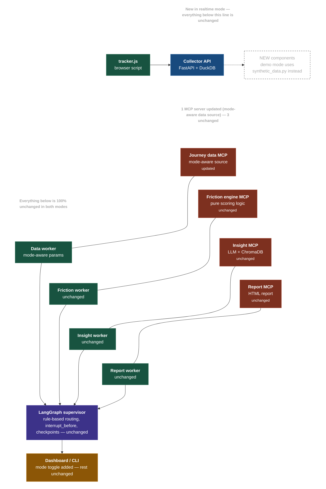

> **Historical design reference (v2.0, March 2026).** Kept unchanged as design intent. Where it differs from
> the code, the code and `README.md` win. Known divergences: `docs/README.md`.

# Customer Journey Intelligence Architecture Flow

The flowchart below models exactly the multi-agent system and server structure you provided in the reference image. 

